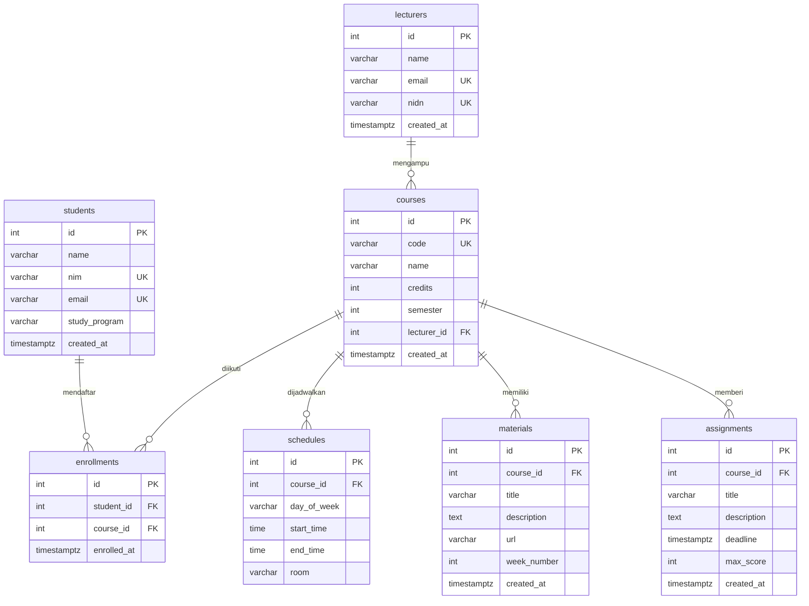

# Akademik API

REST API untuk mengelola **jadwal kuliah, materi kuliah, dan deadline tugas kuliah**. API menyimpan data dosen, mahasiswa, mata kuliah, pendaftaran mata kuliah (KRS), jadwal, materi, dan tugas, sehingga mahasiswa bisa melihat jadwal kuliahnya dan tugas apa yang paling dekat deadline-nya.

Dibangun dengan **Node.js + Express** dan database **PostgreSQL** (Supabase/Neon), lalu di-deploy ke **Vercel**. Dibuat untuk Tugas Akhir Learning Labs: Backend Development.

## Link

| Item | URL |
|------|-----|
| Repository GitHub | `https://github.com/USERNAME/akademik-api` *(ganti dengan link repo Anda)* |
| Deployment (Vercel) | `https://nama-project.vercel.app` *(ganti dengan URL Vercel Anda)* |

> Setelah deploy, ganti `https://nama-project.vercel.app` di dokumen ini dengan URL Vercel yang sebenarnya (Find & Replace), dan juga di variabel `baseUrl` pada koleksi Postman.

## Fitur Utama

- CRUD untuk dosen, mahasiswa, mata kuliah, jadwal, materi, dan tugas.
- Mahasiswa mendaftar ke mata kuliah lewat `enrollments` (relasi many-to-many).
- `GET /students/:id/schedule`: jadwal kuliah mahasiswa, urut hari dan jam.
- `GET /students/:id/deadlines`: deadline tugas mahasiswa, dilengkapi sisa jam (`hours_left`).
- `GET /assignments/upcoming`: tugas yang jatuh tempo dalam N hari ke depan.
- `GET /courses/:id`: detail mata kuliah beserta jadwal, materi, tugas, dan jumlah mahasiswa.
- Validasi input, kode status HTTP yang tepat, dan pesan error berbahasa Indonesia.

## Teknologi

- Node.js 18+, Express 4
- PostgreSQL (driver `pg`), di-host di Supabase / Neon
- Vercel (serverless function)

## ERD / Skema Database

Terdapat **7 tabel**, semuanya punya primary key dan terhubung lewat foreign key.



**Gambar ERD:** tempel isi `db/schema.dbml` ke [dbdiagram.io](https://dbdiagram.io), lalu *Export > PNG* dan simpan sebagai `docs/erd.png`, kemudian tampilkan di sini:

```md

```

**Relasi:**

| Relasi | Jenis | Keterangan |
|--------|-------|------------|
| `lecturers` → `courses` | one-to-many | Satu dosen mengampu banyak mata kuliah |
| `courses` → `schedules` | one-to-many | Satu mata kuliah punya beberapa jadwal per minggu |
| `courses` → `materials` | one-to-many | Satu mata kuliah punya banyak materi (per pertemuan/minggu) |
| `courses` → `assignments` | one-to-many | Satu mata kuliah punya banyak tugas dengan deadline |
| `students` ↔ `courses` | many-to-many | Lewat tabel pivot `enrollments` (pasangan mahasiswa + mata kuliah unik) |

Skema lengkap ada di `db/schema.sql`, data contoh di `db/seed.sql`.

## Ringkasan Endpoint

| Resource | GET | POST | PUT | PATCH | DELETE |
|----------|-----|------|-----|-------|--------|
| `/lecturers` | list, detail | ✔ | ✔ | – | ✔ |
| `/students` | list, detail, `/:id/schedule`, `/:id/deadlines` | ✔ | – | ✔ | ✔ |
| `/courses` | list, detail (lengkap dengan relasi) | ✔ | ✔ | ✔ | ✔ |
| `/enrollments` | list, detail | ✔ | – | – | ✔ |
| `/schedules` | list, detail | ✔ | ✔ | – | ✔ |
| `/materials` | list, detail | ✔ | ✔ | – | ✔ |
| `/assignments` | list, detail, `/upcoming` | ✔ | ✔ | ✔ | ✔ |

Total **39 endpoint**. Resource `/courses` dan `/assignments` memiliki CRUD lengkap (GET, POST, PUT, PATCH, DELETE).

**Aturan umum**

- Request dan response memakai JSON (`Content-Type: application/json` untuk POST/PUT/PATCH).
- Kode status: `200` sukses, `201` data dibuat, `400` input salah, `404` data tidak ditemukan, `409` data duplikat atau masih dipakai, `500` error server.
- Format error selalu `{"error": "pesan"}`.
- `deadline` dikirim dalam format ISO 8601, sebaiknya dengan zona waktu, misalnya `2026-11-20T23:59:00+07:00`. Di response, waktu ditampilkan dalam UTC (`...Z`).
- `day_of_week` bernilai salah satu dari: Senin, Selasa, Rabu, Kamis, Jumat, Sabtu, Minggu. Jam memakai format `HH:MM` (contoh `08:00`).
- Nilai ID pada contoh dokumentasi mengikuti data di `db/seed.sql`. ID data yang baru dibuat (misalnya `3`, `5`) akan berbeda bila Anda sudah menambah data lain.

## Dokumentasi Endpoint

Base URL: `https://nama-project.vercel.app`

### Dosen

#### Daftar Dosen

```
- Method       : GET
- URL          : https://nama-project.vercel.app/lecturers
- Deskripsi    : Mengambil seluruh dosen. Query opsional: search (nama/email)
- Headers      : -
- Request Body : -
- Response Sukses (200):
  {
    "data": [
      {
        "id": 1,
        "name": "Dr. Ahmad Fauzi, M.Kom.",
        "email": "ahmad.fauzi@kampus.ac.id",
        "nidn": "0412038801",
        "created_at": "2026-10-23T11:00:00.000Z"
      }
    ]
  }
- Response Error (500):
  {
    "error": "Terjadi kesalahan pada server"
  }
```

#### Detail Dosen

```
- Method       : GET
- URL          : https://nama-project.vercel.app/lecturers/1
- Deskripsi    : Mengambil satu dosen berdasarkan ID
- Headers      : -
- Request Body : -
- Response Sukses (200):
  {
    "data": {
      "id": 1,
      "name": "Dr. Ahmad Fauzi, M.Kom.",
      "email": "ahmad.fauzi@kampus.ac.id",
      "nidn": "0412038801",
      "created_at": "2026-10-23T11:00:00.000Z"
    }
  }
- Response Error (404):
  {
    "error": "Dosen tidak ditemukan"
  }
```

#### Tambah Dosen

```
- Method       : POST
- URL          : https://nama-project.vercel.app/lecturers
- Deskripsi    : Menambahkan dosen baru
- Headers      : Content-Type: application/json
- Request Body : 
  {
    "name": "Dr. Rina Kartika, M.T.",
    "email": "rina.kartika@kampus.ac.id",
    "nidn": "0420068003"
  }
- Response Sukses (201):
  {
    "message": "Dosen berhasil ditambahkan",
    "data": {
      "id": 3,
      "name": "Dr. Rina Kartika, M.T.",
      "email": "rina.kartika@kampus.ac.id",
      "nidn": "0420068003",
      "created_at": "2026-10-23T11:00:00.000Z"
    }
  }
- Response Error (400) [bila field name tidak dikirim]:
  {
    "error": "Field name wajib diisi"
  }
- Response Error (409) [email atau NIDN sudah dipakai]:
  {
    "error": "Email atau NIDN sudah terdaftar"
  }
```

#### Ubah Dosen (PUT)

```
- Method       : PUT
- URL          : https://nama-project.vercel.app/lecturers/3
- Deskripsi    : Mengganti seluruh data dosen (semua field wajib dikirim)
- Headers      : Content-Type: application/json
- Request Body : 
  {
    "name": "Dr. Rina Kartika, M.T., Ph.D.",
    "email": "rina.kartika@kampus.ac.id",
    "nidn": "0420068003"
  }
- Response Sukses (200):
  {
    "message": "Dosen berhasil diperbarui",
    "data": {
      "id": 3,
      "name": "Dr. Rina Kartika, M.T., Ph.D.",
      "email": "rina.kartika@kampus.ac.id",
      "nidn": "0420068003",
      "created_at": "2026-10-23T11:00:00.000Z"
    }
  }
- Response Error (404):
  {
    "error": "Dosen tidak ditemukan"
  }
- Response Error (400) [bila field name tidak dikirim]:
  {
    "error": "Field name wajib diisi"
  }
```

#### Hapus Dosen

```
- Method       : DELETE
- URL          : https://nama-project.vercel.app/lecturers/3
- Deskripsi    : Menghapus dosen
- Headers      : -
- Request Body : -
- Response Sukses (200):
  {
    "message": "Dosen berhasil dihapus"
  }
- Response Error (404):
  {
    "error": "Dosen tidak ditemukan"
  }
- Response Error (409) [dosen masih mengampu mata kuliah]:
  {
    "error": "Dosen tidak dapat dihapus karena masih dipakai data lain"
  }
```


### Mahasiswa

#### Daftar Mahasiswa

```
- Method       : GET
- URL          : https://nama-project.vercel.app/students
- Deskripsi    : Mengambil seluruh mahasiswa. Query opsional: search (nama/NIM/email)
- Headers      : -
- Request Body : -
- Response Sukses (200):
  {
    "data": [
      {
        "id": 1,
        "name": "Budi Santoso",
        "nim": "2021110001",
        "email": "budi@mahasiswa.kampus.ac.id",
        "study_program": "Teknik Informatika",
        "created_at": "2026-10-23T11:00:00.000Z"
      }
    ]
  }
- Response Error (500):
  {
    "error": "Terjadi kesalahan pada server"
  }
```

#### Detail Mahasiswa

```
- Method       : GET
- URL          : https://nama-project.vercel.app/students/1
- Deskripsi    : Mengambil satu mahasiswa berdasarkan ID
- Headers      : -
- Request Body : -
- Response Sukses (200):
  {
    "data": {
      "id": 1,
      "name": "Budi Santoso",
      "nim": "2021110001",
      "email": "budi@mahasiswa.kampus.ac.id",
      "study_program": "Teknik Informatika",
      "created_at": "2026-10-23T11:00:00.000Z"
    }
  }
- Response Error (404):
  {
    "error": "Mahasiswa tidak ditemukan"
  }
```

#### Jadwal Kuliah Mahasiswa

```
- Method       : GET
- URL          : https://nama-project.vercel.app/students/1/schedule
- Deskripsi    : Jadwal kuliah satu mahasiswa (dari mata kuliah yang ia ikuti), urut hari dan jam. Query opsional: day
- Headers      : -
- Request Body : -
- Response Sukses (200):
  {
    "data": [
      {
        "id": 1,
        "course_code": "IF301",
        "course_name": "Basis Data",
        "day_of_week": "Senin",
        "start_time": "08:00",
        "end_time": "10:30",
        "room": "Lab 2"
      },
      {
        "id": 3,
        "course_code": "IF302",
        "course_name": "Pemrograman Web",
        "day_of_week": "Selasa",
        "start_time": "10:00",
        "end_time": "12:30",
        "room": "Lab 1"
      }
    ]
  }
- Response Error (404):
  {
    "error": "Mahasiswa tidak ditemukan"
  }
- Response Error (400) [contoh: ?day=Monday]:
  {
    "error": "Query day harus salah satu dari: Senin, Selasa, Rabu, Kamis, Jumat, Sabtu, Minggu"
  }
```

#### Deadline Tugas Mahasiswa

```
- Method       : GET
- URL          : https://nama-project.vercel.app/students/1/deadlines
- Deskripsi    : Daftar deadline tugas satu mahasiswa, urut deadline terdekat. Secara bawaan hanya yang belum lewat; tambahkan ?all=true untuk semuanya
- Headers      : -
- Request Body : -
- Response Sukses (200):
  {
    "data": [
      {
        "id": 1,
        "course_code": "IF301",
        "course_name": "Basis Data",
        "title": "Rancang ERD Perpustakaan",
        "deadline": "2026-10-26T11:00:00.000Z",
        "hours_left": 72
      },
      {
        "id": 3,
        "course_code": "IF302",
        "course_name": "Pemrograman Web",
        "title": "Proyek REST API",
        "deadline": "2026-10-28T11:00:00.000Z",
        "hours_left": 120
      }
    ]
  }
- Response Error (404):
  {
    "error": "Mahasiswa tidak ditemukan"
  }
```

#### Tambah Mahasiswa

```
- Method       : POST
- URL          : https://nama-project.vercel.app/students
- Deskripsi    : Menambahkan mahasiswa baru
- Headers      : Content-Type: application/json
- Request Body : 
  {
    "name": "Fajar Nugroho",
    "nim": "2021110005",
    "email": "fajar@mahasiswa.kampus.ac.id",
    "study_program": "Teknik Informatika"
  }
- Response Sukses (201):
  {
    "message": "Mahasiswa berhasil ditambahkan",
    "data": {
      "id": 5,
      "name": "Fajar Nugroho",
      "nim": "2021110005",
      "email": "fajar@mahasiswa.kampus.ac.id",
      "study_program": "Teknik Informatika",
      "created_at": "2026-10-23T11:00:00.000Z"
    }
  }
- Response Error (400) [bila field name tidak dikirim]:
  {
    "error": "Field name wajib diisi"
  }
- Response Error (409) [NIM atau email sudah dipakai]:
  {
    "error": "NIM atau email sudah terdaftar"
  }
```

#### Ubah Sebagian Mahasiswa (PATCH)

```
- Method       : PATCH
- URL          : https://nama-project.vercel.app/students/5
- Deskripsi    : Mengubah sebagian field mahasiswa (field: name, nim, email, study_program)
- Headers      : Content-Type: application/json
- Request Body : 
  {
    "study_program": "Sistem Informasi"
  }
- Response Sukses (200):
  {
    "message": "Mahasiswa berhasil diperbarui",
    "data": {
      "id": 5,
      "name": "Fajar Nugroho",
      "nim": "2021110005",
      "email": "fajar@mahasiswa.kampus.ac.id",
      "study_program": "Sistem Informasi",
      "created_at": "2026-10-23T11:00:00.000Z"
    }
  }
- Response Error (400) [bila body kosong]:
  {
    "error": "Isi minimal satu field: name, nim, email, study_program"
  }
- Response Error (404):
  {
    "error": "Mahasiswa tidak ditemukan"
  }
```

#### Hapus Mahasiswa

```
- Method       : DELETE
- URL          : https://nama-project.vercel.app/students/5
- Deskripsi    : Menghapus mahasiswa
- Headers      : -
- Request Body : -
- Response Sukses (200):
  {
    "message": "Mahasiswa berhasil dihapus"
  }
- Response Error (404):
  {
    "error": "Mahasiswa tidak ditemukan"
  }
```


### Mata Kuliah

#### Daftar Mata Kuliah

```
- Method       : GET
- URL          : https://nama-project.vercel.app/courses
- Deskripsi    : Mengambil seluruh mata kuliah. Query opsional: lecturer_id, semester, search (kode/nama)
- Headers      : -
- Request Body : -
- Response Sukses (200):
  {
    "data": [
      {
        "id": 1,
        "code": "IF301",
        "name": "Basis Data",
        "credits": 3,
        "semester": 5,
        "lecturer_id": 1,
        "lecturer_name": "Dr. Ahmad Fauzi, M.Kom.",
        "created_at": "2026-10-23T11:00:00.000Z"
      }
    ]
  }
- Response Error (400) [contoh: /courses?semester=abc]:
  {
    "error": "Query semester harus berupa bilangan bulat positif"
  }
```

#### Detail Mata Kuliah

```
- Method       : GET
- URL          : https://nama-project.vercel.app/courses/1
- Deskripsi    : Mengambil satu mata kuliah beserta jadwal, materi, tugas, dan jumlah mahasiswa terdaftar
- Headers      : -
- Request Body : -
- Response Sukses (200):
  {
    "data": {
      "id": 1,
      "code": "IF301",
      "name": "Basis Data",
      "credits": 3,
      "semester": 5,
      "lecturer_id": 1,
      "lecturer_name": "Dr. Ahmad Fauzi, M.Kom.",
      "created_at": "2026-10-23T11:00:00.000Z",
      "student_count": 3,
      "schedules": [
        {
          "id": 1,
          "day_of_week": "Senin",
          "start_time": "08:00",
          "end_time": "10:30",
          "room": "Lab 2"
        }
      ],
      "materials": [
        {
          "id": 1,
          "title": "Pengantar Basis Data",
          "url": "https://drive.example.com/basisdata/minggu-1",
          "week_number": 1
        }
      ],
      "assignments": [
        {
          "id": 1,
          "title": "Rancang ERD Perpustakaan",
          "deadline": "2026-10-26T11:00:00.000Z",
          "max_score": 100
        }
      ]
    }
  }
- Response Error (404):
  {
    "error": "Mata kuliah tidak ditemukan"
  }
```

#### Tambah Mata Kuliah

```
- Method       : POST
- URL          : https://nama-project.vercel.app/courses
- Deskripsi    : Menambahkan mata kuliah baru
- Headers      : Content-Type: application/json
- Request Body : 
  {
    "code": "IF304",
    "name": "Kecerdasan Buatan",
    "credits": 3,
    "semester": 5,
    "lecturer_id": 2
  }
- Response Sukses (201):
  {
    "message": "Mata kuliah berhasil ditambahkan",
    "data": {
      "id": 4,
      "code": "IF304",
      "name": "Kecerdasan Buatan",
      "credits": 3,
      "semester": 5,
      "lecturer_id": 2,
      "lecturer_name": "Prof. Siti Rahmawati, Ph.D.",
      "created_at": "2026-10-23T11:00:00.000Z"
    }
  }
- Response Error (400) [bila field code tidak dikirim]:
  {
    "error": "Field code wajib diisi"
  }
- Response Error (400) [bila lecturer_id tidak ada di database]:
  {
    "error": "Data dengan lecturer_id tersebut tidak ditemukan"
  }
- Response Error (409) [kode mata kuliah sudah dipakai]:
  {
    "error": "Kode mata kuliah sudah dipakai"
  }
```

#### Ubah Mata Kuliah (PUT)

```
- Method       : PUT
- URL          : https://nama-project.vercel.app/courses/4
- Deskripsi    : Mengganti seluruh data mata kuliah (semua field wajib dikirim)
- Headers      : Content-Type: application/json
- Request Body : 
  {
    "code": "IF304",
    "name": "Kecerdasan Buatan Lanjut",
    "credits": 3,
    "semester": 6,
    "lecturer_id": 2
  }
- Response Sukses (200):
  {
    "message": "Mata kuliah berhasil diperbarui",
    "data": {
      "id": 4,
      "code": "IF304",
      "name": "Kecerdasan Buatan Lanjut",
      "credits": 3,
      "semester": 6,
      "lecturer_id": 2,
      "lecturer_name": "Prof. Siti Rahmawati, Ph.D.",
      "created_at": "2026-10-23T11:00:00.000Z"
    }
  }
- Response Error (404):
  {
    "error": "Mata kuliah tidak ditemukan"
  }
- Response Error (400) [bila field code tidak dikirim]:
  {
    "error": "Field code wajib diisi"
  }
```

#### Ubah Sebagian Mata Kuliah (PATCH)

```
- Method       : PATCH
- URL          : https://nama-project.vercel.app/courses/4
- Deskripsi    : Mengubah sebagian field mata kuliah (field: code, name, credits, semester, lecturer_id)
- Headers      : Content-Type: application/json
- Request Body : 
  {
    "credits": 4
  }
- Response Sukses (200):
  {
    "message": "Mata kuliah berhasil diperbarui",
    "data": {
      "id": 4,
      "code": "IF304",
      "name": "Kecerdasan Buatan",
      "credits": 4,
      "semester": 5,
      "lecturer_id": 2,
      "lecturer_name": "Prof. Siti Rahmawati, Ph.D.",
      "created_at": "2026-10-23T11:00:00.000Z"
    }
  }
- Response Error (400) [bila body kosong]:
  {
    "error": "Isi minimal satu field: code, name, credits, semester, lecturer_id"
  }
- Response Error (404):
  {
    "error": "Mata kuliah tidak ditemukan"
  }
```

#### Hapus Mata Kuliah

```
- Method       : DELETE
- URL          : https://nama-project.vercel.app/courses/4
- Deskripsi    : Menghapus mata kuliah (jadwal, materi, tugas, dan pendaftaran mata kuliah ikut terhapus)
- Headers      : -
- Request Body : -
- Response Sukses (200):
  {
    "message": "Mata kuliah berhasil dihapus"
  }
- Response Error (404):
  {
    "error": "Mata kuliah tidak ditemukan"
  }
```


### Pendaftaran Kuliah (KRS)

#### Daftar Pendaftaran Kuliah

```
- Method       : GET
- URL          : https://nama-project.vercel.app/enrollments
- Deskripsi    : Mengambil seluruh pendaftaran kuliah. Query opsional: student_id, course_id
- Headers      : -
- Request Body : -
- Response Sukses (200):
  {
    "data": [
      {
        "id": 1,
        "student_id": 1,
        "student_name": "Budi Santoso",
        "nim": "2021110001",
        "course_id": 1,
        "course_code": "IF301",
        "course_name": "Basis Data",
        "enrolled_at": "2026-10-23T11:00:00.000Z"
      }
    ]
  }
- Response Error (400) [contoh: /enrollments?student_id=abc]:
  {
    "error": "Query student_id harus berupa bilangan bulat positif"
  }
```

#### Detail Pendaftaran Kuliah

```
- Method       : GET
- URL          : https://nama-project.vercel.app/enrollments/1
- Deskripsi    : Mengambil satu pendaftaran kuliah berdasarkan ID
- Headers      : -
- Request Body : -
- Response Sukses (200):
  {
    "data": {
      "id": 1,
      "student_id": 1,
      "student_name": "Budi Santoso",
      "nim": "2021110001",
      "course_id": 1,
      "course_code": "IF301",
      "course_name": "Basis Data",
      "enrolled_at": "2026-10-23T11:00:00.000Z"
    }
  }
- Response Error (404):
  {
    "error": "Pendaftaran kuliah tidak ditemukan"
  }
```

#### Tambah Pendaftaran Kuliah

```
- Method       : POST
- URL          : https://nama-project.vercel.app/enrollments
- Deskripsi    : Menambahkan pendaftaran kuliah baru
- Headers      : Content-Type: application/json
- Request Body : 
  {
    "student_id": 4,
    "course_id": 2
  }
- Response Sukses (201):
  {
    "message": "Pendaftaran kuliah berhasil ditambahkan",
    "data": {
      "id": 8,
      "student_id": 4,
      "student_name": "Eka Putri",
      "nim": "2021110004",
      "course_id": 2,
      "course_code": "IF302",
      "course_name": "Pemrograman Web",
      "enrolled_at": "2026-10-23T11:00:00.000Z"
    }
  }
- Response Error (400) [bila field student_id tidak dikirim]:
  {
    "error": "Field student_id wajib diisi"
  }
- Response Error (400) [bila student_id tidak ada di database]:
  {
    "error": "Data dengan student_id tersebut tidak ditemukan"
  }
- Response Error (409) [mahasiswa sudah terdaftar di mata kuliah tersebut]:
  {
    "error": "Mahasiswa sudah terdaftar di mata kuliah tersebut"
  }
```

#### Hapus Pendaftaran Kuliah

```
- Method       : DELETE
- URL          : https://nama-project.vercel.app/enrollments/8
- Deskripsi    : Menghapus pendaftaran kuliah
- Headers      : -
- Request Body : -
- Response Sukses (200):
  {
    "message": "Pendaftaran kuliah berhasil dihapus"
  }
- Response Error (404):
  {
    "error": "Pendaftaran kuliah tidak ditemukan"
  }
```


### Jadwal Kuliah

#### Daftar Jadwal Kuliah

```
- Method       : GET
- URL          : https://nama-project.vercel.app/schedules
- Deskripsi    : Mengambil seluruh jadwal kuliah. Query opsional: course_id, day (Senin/Selasa/Rabu/Kamis/Jumat/Sabtu/Minggu). Hasil diurutkan berdasarkan hari dan jam mulai
- Headers      : -
- Request Body : -
- Response Sukses (200):
  {
    "data": [
      {
        "id": 1,
        "course_id": 1,
        "course_code": "IF301",
        "course_name": "Basis Data",
        "day_of_week": "Senin",
        "start_time": "08:00",
        "end_time": "10:30",
        "room": "Lab 2"
      }
    ]
  }
- Response Error (400) [contoh: /schedules?day=Monday]:
  {
    "error": "Query day harus salah satu dari: Senin, Selasa, Rabu, Kamis, Jumat, Sabtu, Minggu"
  }
```

#### Detail Jadwal Kuliah

```
- Method       : GET
- URL          : https://nama-project.vercel.app/schedules/1
- Deskripsi    : Mengambil satu jadwal kuliah berdasarkan ID
- Headers      : -
- Request Body : -
- Response Sukses (200):
  {
    "data": {
      "id": 1,
      "course_id": 1,
      "course_code": "IF301",
      "course_name": "Basis Data",
      "day_of_week": "Senin",
      "start_time": "08:00",
      "end_time": "10:30",
      "room": "Lab 2"
    }
  }
- Response Error (404):
  {
    "error": "Jadwal kuliah tidak ditemukan"
  }
```

#### Tambah Jadwal Kuliah

```
- Method       : POST
- URL          : https://nama-project.vercel.app/schedules
- Deskripsi    : Menambahkan jadwal kuliah baru
- Headers      : Content-Type: application/json
- Request Body : 
  {
    "course_id": 3,
    "day_of_week": "Senin",
    "start_time": "13:00",
    "end_time": "14:40",
    "room": "R. 101"
  }
- Response Sukses (201):
  {
    "message": "Jadwal kuliah berhasil ditambahkan",
    "data": {
      "id": 6,
      "course_id": 3,
      "course_code": "IF303",
      "course_name": "Statistika",
      "day_of_week": "Senin",
      "start_time": "13:00",
      "end_time": "14:40",
      "room": "R. 101"
    }
  }
- Response Error (400) [bila field course_id tidak dikirim]:
  {
    "error": "Field course_id wajib diisi"
  }
- Response Error (400) [bila course_id tidak ada di database]:
  {
    "error": "Data dengan course_id tersebut tidak ditemukan"
  }
- Response Error (400) [bila jam selesai <= jam mulai]:
  {
    "error": "Field end_time harus lebih besar dari start_time"
  }
```

#### Ubah Jadwal Kuliah (PUT)

```
- Method       : PUT
- URL          : https://nama-project.vercel.app/schedules/6
- Deskripsi    : Mengganti seluruh data jadwal kuliah (semua field wajib dikirim)
- Headers      : Content-Type: application/json
- Request Body : 
  {
    "course_id": 3,
    "day_of_week": "Senin",
    "start_time": "13:00",
    "end_time": "14:40",
    "room": "R. 102"
  }
- Response Sukses (200):
  {
    "message": "Jadwal kuliah berhasil diperbarui",
    "data": {
      "id": 6,
      "course_id": 3,
      "course_code": "IF303",
      "course_name": "Statistika",
      "day_of_week": "Senin",
      "start_time": "13:00",
      "end_time": "14:40",
      "room": "R. 102"
    }
  }
- Response Error (404):
  {
    "error": "Jadwal kuliah tidak ditemukan"
  }
- Response Error (400) [bila field course_id tidak dikirim]:
  {
    "error": "Field course_id wajib diisi"
  }
```

#### Hapus Jadwal Kuliah

```
- Method       : DELETE
- URL          : https://nama-project.vercel.app/schedules/6
- Deskripsi    : Menghapus jadwal kuliah
- Headers      : -
- Request Body : -
- Response Sukses (200):
  {
    "message": "Jadwal kuliah berhasil dihapus"
  }
- Response Error (404):
  {
    "error": "Jadwal kuliah tidak ditemukan"
  }
```


### Materi Kuliah

#### Daftar Materi Kuliah

```
- Method       : GET
- URL          : https://nama-project.vercel.app/materials
- Deskripsi    : Mengambil seluruh materi kuliah. Query opsional: course_id, week_number, search (judul/deskripsi)
- Headers      : -
- Request Body : -
- Response Sukses (200):
  {
    "data": [
      {
        "id": 1,
        "course_id": 1,
        "course_code": "IF301",
        "course_name": "Basis Data",
        "title": "Pengantar Basis Data",
        "description": "Konsep dasar DBMS dan model relasional",
        "url": "https://drive.example.com/basisdata/minggu-1",
        "week_number": 1,
        "created_at": "2026-10-23T11:00:00.000Z"
      }
    ]
  }
- Response Error (400) [contoh: /materials?course_id=abc]:
  {
    "error": "Query course_id harus berupa bilangan bulat positif"
  }
```

#### Detail Materi Kuliah

```
- Method       : GET
- URL          : https://nama-project.vercel.app/materials/1
- Deskripsi    : Mengambil satu materi kuliah berdasarkan ID
- Headers      : -
- Request Body : -
- Response Sukses (200):
  {
    "data": {
      "id": 1,
      "course_id": 1,
      "course_code": "IF301",
      "course_name": "Basis Data",
      "title": "Pengantar Basis Data",
      "description": "Konsep dasar DBMS dan model relasional",
      "url": "https://drive.example.com/basisdata/minggu-1",
      "week_number": 1,
      "created_at": "2026-10-23T11:00:00.000Z"
    }
  }
- Response Error (404):
  {
    "error": "Materi kuliah tidak ditemukan"
  }
```

#### Tambah Materi Kuliah

```
- Method       : POST
- URL          : https://nama-project.vercel.app/materials
- Deskripsi    : Menambahkan materi kuliah baru
- Headers      : Content-Type: application/json
- Request Body : 
  {
    "course_id": 1,
    "title": "Query SQL Lanjutan",
    "description": "JOIN, subquery, dan agregasi",
    "url": "https://drive.example.com/basisdata/minggu-5",
    "week_number": 5
  }
- Response Sukses (201):
  {
    "message": "Materi kuliah berhasil ditambahkan",
    "data": {
      "id": 6,
      "course_id": 1,
      "course_code": "IF301",
      "course_name": "Basis Data",
      "title": "Query SQL Lanjutan",
      "description": "JOIN, subquery, dan agregasi",
      "url": "https://drive.example.com/basisdata/minggu-5",
      "week_number": 5,
      "created_at": "2026-10-23T11:00:00.000Z"
    }
  }
- Response Error (400) [bila field course_id tidak dikirim]:
  {
    "error": "Field course_id wajib diisi"
  }
- Response Error (400) [bila course_id tidak ada di database]:
  {
    "error": "Data dengan course_id tersebut tidak ditemukan"
  }
```

#### Ubah Materi Kuliah (PUT)

```
- Method       : PUT
- URL          : https://nama-project.vercel.app/materials/6
- Deskripsi    : Mengganti seluruh data materi kuliah (semua field wajib dikirim)
- Headers      : Content-Type: application/json
- Request Body : 
  {
    "course_id": 1,
    "title": "Query SQL Lanjutan",
    "description": "JOIN, subquery, agregasi, dan view",
    "url": "https://drive.example.com/basisdata/minggu-5",
    "week_number": 6
  }
- Response Sukses (200):
  {
    "message": "Materi kuliah berhasil diperbarui",
    "data": {
      "id": 6,
      "course_id": 1,
      "course_code": "IF301",
      "course_name": "Basis Data",
      "title": "Query SQL Lanjutan",
      "description": "JOIN, subquery, agregasi, dan view",
      "url": "https://drive.example.com/basisdata/minggu-5",
      "week_number": 6,
      "created_at": "2026-10-23T11:00:00.000Z"
    }
  }
- Response Error (404):
  {
    "error": "Materi kuliah tidak ditemukan"
  }
- Response Error (400) [bila field course_id tidak dikirim]:
  {
    "error": "Field course_id wajib diisi"
  }
```

#### Hapus Materi Kuliah

```
- Method       : DELETE
- URL          : https://nama-project.vercel.app/materials/6
- Deskripsi    : Menghapus materi kuliah
- Headers      : -
- Request Body : -
- Response Sukses (200):
  {
    "message": "Materi kuliah berhasil dihapus"
  }
- Response Error (404):
  {
    "error": "Materi kuliah tidak ditemukan"
  }
```


### Tugas dan Deadline

#### Daftar Tugas

```
- Method       : GET
- URL          : https://nama-project.vercel.app/assignments
- Deskripsi    : Mengambil seluruh tugas. Query opsional: course_id, search (judul/deskripsi). Hasil diurutkan berdasarkan deadline terdekat
- Headers      : -
- Request Body : -
- Response Sukses (200):
  {
    "data": [
      {
        "id": 1,
        "course_id": 1,
        "course_code": "IF301",
        "course_name": "Basis Data",
        "title": "Rancang ERD Perpustakaan",
        "description": "Buat ERD minimal 5 tabel beserta relasinya",
        "deadline": "2026-10-26T11:00:00.000Z",
        "max_score": 100,
        "created_at": "2026-10-23T11:00:00.000Z"
      }
    ]
  }
- Response Error (400) [contoh: /assignments?course_id=abc]:
  {
    "error": "Query course_id harus berupa bilangan bulat positif"
  }
```

#### Tugas yang Akan Jatuh Tempo

```
- Method       : GET
- URL          : https://nama-project.vercel.app/assignments/upcoming?days=7
- Deskripsi    : Tugas dengan deadline dalam N hari ke depan (bawaan 7). Query opsional: days (1-365), course_id
- Headers      : -
- Request Body : -
- Response Sukses (200):
  {
    "data": [
      {
        "id": 4,
        "course_id": 3,
        "course_code": "IF303",
        "course_name": "Statistika",
        "title": "Laporan Statistik Deskriptif",
        "deadline": "2026-10-25T11:00:00.000Z",
        "hours_left": 48
      },
      {
        "id": 1,
        "course_id": 1,
        "course_code": "IF301",
        "course_name": "Basis Data",
        "title": "Rancang ERD Perpustakaan",
        "deadline": "2026-10-26T11:00:00.000Z",
        "hours_left": 72
      }
    ]
  }
- Response Error (400) [contoh: ?days=0]:
  {
    "error": "Query days harus berupa bilangan bulat antara 1 dan 365"
  }
```

#### Detail Tugas

```
- Method       : GET
- URL          : https://nama-project.vercel.app/assignments/1
- Deskripsi    : Mengambil satu tugas berdasarkan ID
- Headers      : -
- Request Body : -
- Response Sukses (200):
  {
    "data": {
      "id": 1,
      "course_id": 1,
      "course_code": "IF301",
      "course_name": "Basis Data",
      "title": "Rancang ERD Perpustakaan",
      "description": "Buat ERD minimal 5 tabel beserta relasinya",
      "deadline": "2026-10-26T11:00:00.000Z",
      "max_score": 100,
      "created_at": "2026-10-23T11:00:00.000Z"
    }
  }
- Response Error (404):
  {
    "error": "Tugas tidak ditemukan"
  }
```

#### Tambah Tugas

```
- Method       : POST
- URL          : https://nama-project.vercel.app/assignments
- Deskripsi    : Menambahkan tugas baru
- Headers      : Content-Type: application/json
- Request Body : 
  {
    "course_id": 2,
    "title": "Tugas Akhir Backend",
    "description": "Bangun REST API minimal 5 tabel",
    "deadline": "2026-11-20T23:59:00+07:00",
    "max_score": 100
  }
- Response Sukses (201):
  {
    "message": "Tugas berhasil ditambahkan",
    "data": {
      "id": 6,
      "course_id": 2,
      "course_code": "IF302",
      "course_name": "Pemrograman Web",
      "title": "Tugas Akhir Backend",
      "description": "Bangun REST API minimal 5 tabel",
      "deadline": "2026-11-20T16:59:00.000Z",
      "max_score": 100,
      "created_at": "2026-10-23T11:00:00.000Z"
    }
  }
- Response Error (400) [bila field course_id tidak dikirim]:
  {
    "error": "Field course_id wajib diisi"
  }
- Response Error (400) [bila course_id tidak ada di database]:
  {
    "error": "Data dengan course_id tersebut tidak ditemukan"
  }
```

#### Ubah Tugas (PUT)

```
- Method       : PUT
- URL          : https://nama-project.vercel.app/assignments/6
- Deskripsi    : Mengganti seluruh data tugas (semua field wajib dikirim)
- Headers      : Content-Type: application/json
- Request Body : 
  {
    "course_id": 2,
    "title": "Tugas Akhir Backend",
    "description": "Bangun REST API minimal 5 tabel dan deploy ke Vercel",
    "deadline": "2026-11-22T23:59:00+07:00",
    "max_score": 100
  }
- Response Sukses (200):
  {
    "message": "Tugas berhasil diperbarui",
    "data": {
      "id": 6,
      "course_id": 2,
      "course_code": "IF302",
      "course_name": "Pemrograman Web",
      "title": "Tugas Akhir Backend",
      "description": "Bangun REST API minimal 5 tabel dan deploy ke Vercel",
      "deadline": "2026-11-22T16:59:00.000Z",
      "max_score": 100,
      "created_at": "2026-10-23T11:00:00.000Z"
    }
  }
- Response Error (404):
  {
    "error": "Tugas tidak ditemukan"
  }
- Response Error (400) [bila field course_id tidak dikirim]:
  {
    "error": "Field course_id wajib diisi"
  }
```

#### Ubah Sebagian Tugas (PATCH)

```
- Method       : PATCH
- URL          : https://nama-project.vercel.app/assignments/6
- Deskripsi    : Mengubah sebagian field tugas (field: course_id, title, description, deadline, max_score)
- Headers      : Content-Type: application/json
- Request Body : 
  {
    "deadline": "2026-11-25T23:59:00+07:00"
  }
- Response Sukses (200):
  {
    "message": "Tugas berhasil diperbarui",
    "data": {
      "id": 6,
      "course_id": 2,
      "course_code": "IF302",
      "course_name": "Pemrograman Web",
      "title": "Tugas Akhir Backend",
      "description": "Bangun REST API minimal 5 tabel",
      "deadline": "2026-11-25T16:59:00.000Z",
      "max_score": 100,
      "created_at": "2026-10-23T11:00:00.000Z"
    }
  }
- Response Error (400) [bila body kosong]:
  {
    "error": "Isi minimal satu field: course_id, title, description, deadline, max_score"
  }
- Response Error (404):
  {
    "error": "Tugas tidak ditemukan"
  }
```

#### Hapus Tugas

```
- Method       : DELETE
- URL          : https://nama-project.vercel.app/assignments/6
- Deskripsi    : Menghapus tugas
- Headers      : -
- Request Body : -
- Response Sukses (200):
  {
    "message": "Tugas berhasil dihapus"
  }
- Response Error (404):
  {
    "error": "Tugas tidak ditemukan"
  }
```

## Cara Menjalankan Secara Lokal

1. **Clone dan install dependency**

   ```bash
   git clone https://github.com/USERNAME/akademik-api.git
   cd akademik-api
   npm install
   ```

2. **Siapkan database online** (Supabase atau Neon), lalu salin connection string PostgreSQL-nya.

3. **Buat file `.env`** dari contoh, lalu isi `DATABASE_URL`:

   ```bash
   cp .env.example .env
   ```

4. **Buat tabel dan isi data contoh** (atau jalankan `db/schema.sql` lalu `db/seed.sql` lewat SQL Editor):

   ```bash
   npm run db:init -- --seed
   ```

   > Peringatan: `schema.sql` menjalankan `DROP TABLE`, jadi semua data lama pada tabel dengan nama yang sama akan hilang.

5. **Jalankan server**

   ```bash
   npm run dev
   ```

   API aktif di `http://localhost:3000`.

6. *(Opsional)* Jalankan uji validasi input, tidak membutuhkan database:

   ```bash
   npm run test:validate
   ```

## Deploy ke Vercel

1. Push project ke GitHub (pastikan `.env` tidak ikut, sudah ada di `.gitignore`).
2. Di [vercel.com](https://vercel.com), pilih **Add New > Project** dan impor repository.
3. Pada **Environment Variables**, tambahkan `DATABASE_URL` berisi connection string database online.
4. Klik **Deploy**. Konfigurasi `vercel.json` meneruskan semua route ke `api/index.js`.
5. Buka `https://nama-project.vercel.app/` dan pastikan muncul pesan `Akademik API berjalan`.

Tips koneksi: pada Supabase gunakan connection string mode *pooler* (port 6543) agar cocok dengan serverless. Neon sudah menyediakan pooled connection string.

## Pengujian (Postman / Thunder Client)

- Impor `postman/akademik-api.postman_collection.json` ke Postman (atau Thunder Client: *Collections > Import*).
- Ubah variabel koleksi `baseUrl` ke URL Vercel Anda.
- Jalankan folder dari atas ke bawah (atau *Run collection*). Setiap request punya uji status code otomatis. Request `POST` menyimpan ID data baru ke variabel koleksi, lalu dipakai oleh request `PUT`, `PATCH`, dan `DELETE` berikutnya, jadi tidak perlu mengedit URL manual.
- Folder **Skenario Error** membuktikan respons `400`, `404`, dan `409`.
- Simpan screenshot request + response (atau export hasil koleksi) sebagai bukti pengujian.
- Koleksi mengasumsikan data awal dari `db/seed.sql` (dosen ID 1-2, mahasiswa ID 1-4, mata kuliah ID 1-3).

## Struktur Project

```
akademik-api/
├── api/index.js          # entry point Vercel
├── src/
│   ├── app.js            # Express app + error handler
│   ├── server.js         # server lokal
│   ├── db.js             # koneksi PostgreSQL
│   ├── schemas.js        # definisi field tiap resource
│   ├── validate.js       # validasi input
│   ├── crud.js           # pembuat router CRUD
│   ├── utils.js
│   └── routes/           # lecturers, students, courses, enrollments,
│                         # schedules, materials, assignments
├── db/                   # schema.sql, seed.sql, schema.dbml, init.js
├── postman/              # koleksi pengujian
├── test/validate.test.js
├── vercel.json
└── .env.example
```
